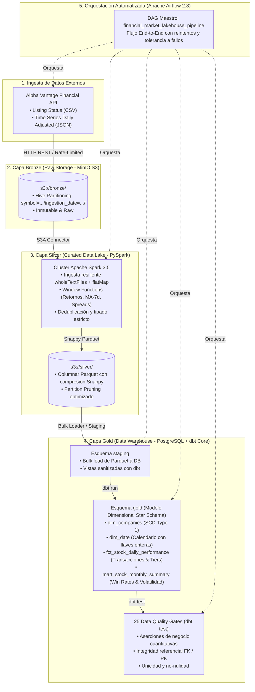
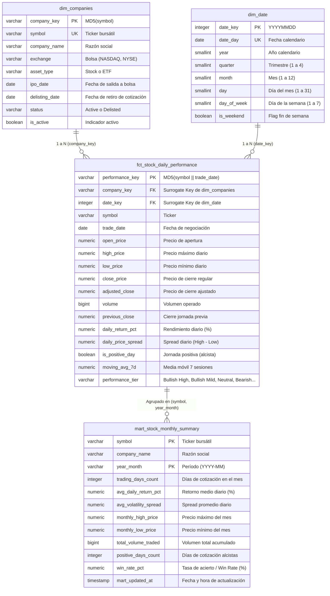
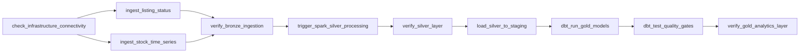

# 🚀 Financial-Market-Lakehouse-Pipeline
### Arquitectura Medallón (Bronze - Silver - Gold) para Análisis Cuantitativo Bursátil


Bienvenido a la documentación técnica de **Financial-Market-Lakehouse-Pipeline**. Este proyecto es una solución integral de ingeniería de datos que implementa la arquitectura **Medallion Lakehouse** (Bronze ➔ Silver ➔ Gold) para la ingesta, procesamiento masivo distribuido, modelado dimensional (*Star Schema*) y validación de calidad de datos financieros del mercado de valores de Nueva York (NYSE y NASDAQ).

---

## 1. Visión General de la Arquitectura

El diseño sigue el principio fundamental de la ingeniería de datos moderna: **desacople absoluto entre almacenamiento y cómputo**.



### Componentes Tecnológicos:
1. **Object Storage (Data Lake - MinIO)**: Compatible 100% con la API de Amazon S3. Almacena capas Bronze (datos crudos e inmutables) y Silver (tablas consolidadas en formato Parquet particionado).
2. **Motor de Computación Distribuida (Apache Spark 3.5)**: Ejecuta transformaciones masivas en memoria (PySpark) para limpiar, tipar, calcular indicadores financieros y persistir en Parquet con compresión Snappy.
3. **Data Warehouse Analítico (PostgreSQL 15)**: Aloja el esquema de staging y el esquema dimensional analítico `gold`.
4. **Transformación y Modelado Dimensional (dbt Core 1.13)**: Construye vistas de staging, tablas de dimensiones, hechos y marts agregados siguiendo la metodología Kimball.
5. **Data Quality Framework (dbt Tests)**: Suite de 25 pruebas automatizadas (integridad referencial, unicidad, no-nulidad, valores admitidos y tests personalizados en SQL).
6. **Orquestación End-to-End (Apache Airflow 2.8)**: Pipeline programado con validación de infraestructura, trazabilidad y tolerancia a fallos.

---

## 2. Estructura del Repositorio

```text
Financial-Market-Lakehouse-Pipeline/
│
├── .env.example                      # Plantilla documentada de variables de entorno y credenciales
├── .env                              # Variables locales activas (ignorado por Git por seguridad)
├── .gitignore                        # Reglas estrictas de exclusión (secretos, temporales, venvs)
├── docker-compose.yml                # Orquestación de infraestructura multi-contenedor
├── README.md                         # Documentación técnica exhaustiva para reclutadores
│
├── config/                           # Configuraciones compartidas entre servicios
│   └── spark-defaults.conf           # Conexión S3A y credenciales MinIO para Apache Spark
│
├── dags/                             # Grafos de orquestación de Apache Airflow
│   ├── financial_bronze_ingestion_dag.py # DAG End-to-End (Bronze -> Silver -> Gold -> Tests)
│   └── utils/                        # Módulos reutilizables de ingesta, almacenamiento y DW
│       ├── __init__.py
│       ├── alpha_vantage_client.py   # Cliente HTTP con rate-limiting y generador sintético
│       ├── minio_storage.py          # Wrapper S3 para uploads, creación de buckets e idempotencia
│       └── dw_loader.py              # Cargador masivo (bulk loader) Parquet -> PostgreSQL Staging
│
├── docker/                           # Definiciones de contenedores
│   └── minio/
│       └── Dockerfile                # Compilación multi-stage de MinIO
│
├── spark_jobs/                       # Cómputo distribuido PySpark (Capa Silver)
│   ├── bronze_to_silver.py           # Job distribuido: parseo dinámico, window metrics y Parquet
│   └── spark_server.py               # Despachador REST (puerto 5050) para desacoplar Airflow y Spark
│
├── dbt_financial/                    # Proyecto dbt Core (Capa Gold y Data Quality)
│   ├── dbt_project.yml               # Configuración global del proyecto y esquemas
│   ├── profiles.yml                  # Perfil de conexión a PostgreSQL financial_dw
│   ├── macros/                       # Macros personalizadas de dbt
│   │   └── generate_schema_name.sql  # Sobrescritura limpia de esquemas (staging / gold)
│   ├── models/
│   │   ├── staging/                  # Capa Staging: Vistas de limpieza y tipado
│   │   │   ├── sources.yml           # Declaración formal de fuentes de staging
│   │   │   ├── schema.yml            # Contratos de datos y pruebas de staging
│   │   │   ├── stg_company_listings.sql
│   │   │   └── stg_stock_prices.sql
│   │   └── marts/                    # Capa Gold: Modelo Dimensional en Estrella (Star Schema)
│   │       ├── schema.yml            # Documentación y 23 pruebas de integridad y rangos
│   │       ├── dim_companies.sql     # Dimensión de empresas con Surrogate Key MD5
│   │       ├── dim_date.sql          # Dimensión de calendario con claves enteras YYYYMMDD
│   │       ├── fct_stock_daily_performance.sql # Tabla de hechos de rendimiento diario
│   │       └── mart_stock_monthly_summary.sql  # Data Mart mensual con Win Rates y Volatilidad
│   └── tests/                        # Pruebas singulares de negocio personalizadas
│       ├── assert_positive_stock_prices.sql # Valida que los precios bursátiles sean > 0
│       └── assert_valid_daily_returns.sql   # Valida coherencia matemática de retornos diarios
│
├── sql/                              # Scripts DDL y de inicialización de bases de datos
│   └── init-db.sql                   # Crea automáticamente bases airflow y financial_dw
│
└── logs/                             # Trazas de ejecución locales de Airflow y Spark
    └── .gitkeep
```

---

## 3. Topología de Infraestructura Docker

Todos los componentes corren aislados dentro de la red virtual `lakehouse_net`:

| Contenedor | Imagen | Puertos | Propósito Arquitectónico |
| :--- | :--- | :--- | :--- |
| **`lakehouse_minio`** | `docker-minio:latest` | `9000` (API S3), `9001` (Web Console) | Data Lake de almacenamiento de objetos (Bronze y Silver) |
| **`postgres_lakehouse`** | `postgres:15-alpine` | `5432` | Data Warehouse relacional (`financial_dw`) y metadatos de Airflow |
| **`lakehouse_spark_master`** | `bitnamilegacy/spark:3.5.0` | `7077` (Cluster), `8081` (UI), `5050` (REST Server) | Nodo Maestro del cluster Spark y despachador de jobs |
| **`lakehouse_spark_worker`** | `bitnamilegacy/spark:3.5.0` | `8082` (UI) | Nodo Trabajador de cómputo en memoria |
| **`lakehouse_airflow`** | `apache/airflow:2.8.1` | `8085` (Web UI) | Orquestador maestro del pipeline y ejecutor de dbt Core |

---

## 4. Capa Bronze: Ingesta Cruda y Contrato de Particionamiento Hive

La **Capa Bronze** preserva la fidelidad absoluta de la fuente original sin mutación:
- **Catálogo de Empresas y ETFs (`LISTING_STATUS`)**: Ingestado en formato CSV crudo.
- **Series Temporales Ajustadas (`TIME_SERIES_DAILY_ADJUSTED`)**: Ingestadas en formato JSON nativo de Alpha Vantage.

### Estructura de Particionamiento Hive:
```text
s3://bronze/alpha_vantage/listing_status/ingestion_date=YYYY-MM-DD/listing_status.csv
s3://bronze/alpha_vantage/time_series_daily/symbol=AAPL/ingestion_date=YYYY-MM-DD/daily_adjusted.json
s3://bronze/alpha_vantage/time_series_daily/symbol=MSFT/ingestion_date=YYYY-MM-DD/daily_adjusted.json
```

### ¿Por qué esta estructura ahorra hasta un 95% de I/O en Apache Spark?
* **Sin Particionamiento (Full Scan tradicional)**: Si todos los activos estuvieran en una carpeta plana, una consulta sobre `AAPL` obligaría a Spark a leer gigabytes de datos de red, deserializar miles de archivos y filtrar en memoria RAM, causando cuellos de botella e ineficiencias severas de red.
* **Con Hive Partitioning (`Partition Pruning`)**: El optimizador **Catalyst** de Apache Spark detecta los predicados de filtrado (`symbol = 'AAPL'`) y lee **únicamente** la subcarpeta correspondiente en MinIO, evitando transferir por red el 95% de los datos irrelevantes.

---

## 5. Capa Silver: Procesamiento Distribuido con Apache Spark (PySpark)

La **Capa Silver** transforma los datos crudos en conjuntos de datos normalizados, limpios, tipados y enriquecidos con métricas cuantitativas en formato Parquet comprimido con Snappy:

```text
s3a://silver/financial_market/company_listings/
s3a://silver/financial_market/stock_prices/symbol=AAPL/
s3a://silver/financial_market/stock_prices/symbol=MSFT/
```

### Hitos de Ingeniería Implementados en PySpark:
1. **Manejo de Claves Dinámicas en JSON**: Las APIs financieras devuelven fechas en las claves (`"2026-10-19": { "1. open": "180.20", ... }`). Spark lee los archivos mediante `wholeTextFiles` y los transforma con un `flatMap` distribuido resiliente que evita errores de schema mismatch.
2. **Cálculo de Indicadores Bursátiles (Window Functions)**:
   - `previous_close`: Cierre del día bursátil anterior usando `lag("close_price", 1).over(window_spec)`.
   - `daily_return_pct`: Retorno diario porcentual: `((adjusted_close - prev_close) / prev_close) * 100`.
   - `daily_price_spread`: Rango de oscilación intradía: `high_price - low_price`.
   - `is_positive_day`: Bandera de jornada alcista: `close_price >= open_price`.
   - `moving_avg_7d`: Media móvil simple de 7 ruedas: `avg("close_price").over(window_7d)`.
3. **Despacho REST Desacoplado**: En lugar de exponer sockets de Docker con riesgos de seguridad, Spark Master aloja un despachador REST interno en el puerto `5050` que ejecuta `spark-submit` bajo demanda al recibir `POST /run-silver`.

---

## 6. Capa Gold: Modelado Dimensional Star Schema y dbt Core

La **Capa Gold** reside en PostgreSQL (`financial_dw`) y modela la información para consumo directo por analistas cuantitativos, algoritmos de trading o tableros de BI (PowerBI, Tableau, Superset).

### Diagrama Entidad-Relación: Modelo en Estrella (Kimball Star Schema)



### Detalle de Modelos dbt:
1. **Capa Staging (`staging`)**:
   - `stg_company_listings`: Vista que sanitiza empresas, normaliza nombres y valida valores nulos.
   - `stg_stock_prices`: Vista que asegura la integridad de tipos numéricos y descarta registros malformados.
2. **Dimensiones Conformes (`gold`)**:
   - `dim_companies`: Contiene la Surrogate Key MD5 generada deterministicamente por símbolo bursátil, permitiendo rastrear activos independientemente de cambios de plataforma.
   - `dim_date`: Dimensión de tiempo canónica que permite análisis agregados por año, trimestre, mes y día de la semana, evitando joins costosos en tiempo de ejecución.
3. **Tabla de Hechos (`gold.fct_stock_daily_performance`)**:
   - Grano: **Un registro por activo financiero por cada fecha bursátil negociada**.
   - Integra la lógica analítica de negocio que categoriza cada sesión en un estrato de rendimiento (`performance_tier`):
     * `Bullish High` (Retorno > +2%)
     * `Bullish Mild` (Retorno entre +0.5% y +2%)
     * `Neutral` (Retorno entre -0.5% y +0.5%)
     * `Bearish Mild` (Retorno entre -2% y -0.5%)
     * `Bearish High` (Retorno < -2%)
4. **Data Mart Agregado (`gold.mart_stock_monthly_summary`)**:
   - Grano: **Un registro por símbolo por mes calendario**.
   - Métricas analíticas avanzadas: Win Rate mensual (`monthly_win_rate_pct = (positive_days / trading_days) * 100`) y volatilidad mensual del activo mediante la desviación estándar muestral (`STDDEV_SAMP(daily_return_pct)`).

---

## 7. Data Quality & Gobernanza: 25 Pruebas Automatizadas en dbt

Para garantizar la fiabilidad del Lakehouse para decisiones financieras, el pipeline implementa **25 pruebas automáticas de calidad de datos** ejecutadas como Quality Gates en cada corrida:

| Categoría de Prueba | Modelos Auditados | Regla de Validación | Resultado |
| :--- | :--- | :--- | :--- |
| **Unicidad (`unique`)** | `dim_companies`, `dim_date`, `fct_stock_daily_performance`, `stg_company_listings` | Garantiza ausencia total de duplicados en claves primarias y sustitutas | ✅ PASS |
| **No Nulidad (`not_null`)** | Todas las PKs, FKs, fechas bursátiles, símbolos y precios de cierre | Impide la propagación de valores nulos o campos corruptos | ✅ PASS |
| **Integridad Referencial (`relationships`)** | `fct_stock_daily_performance` ➔ `dim_companies`, `dim_date` | Asegura que ninguna transacción apunte a una empresa o fecha inexistente | ✅ PASS |
| **Valores Aceptados (`accepted_values`)** | `performance_tier` | Restringe el campo categórico a los 5 tiers bursátiles definidos | ✅ PASS |
| **Aserción de Precios Positivos (`assert_positive_stock_prices.sql`)** | Precios de apertura, máximos, mínimos, cierres y ajustados | Test SQL que detecta anomalías donde un precio sea menor o igual a cero | ✅ PASS |
| **Aserción de Retornos Coherentes (`assert_valid_daily_returns.sql`)** | Retornos porcentuales diarios | Detecta variaciones matemáticas anómalas superiores al ±100% intradía | ✅ PASS |

**Resultado global verificado:**
```text
Finished running 25 data tests in 0 hours 0 minutes and 0.89 seconds.
Done. PASS=25 WARN=0 ERROR=0 SKIP=0 TOTAL=25
```

---

## 8. Orquestación End-to-End con Apache Airflow

El pipeline completo se orquesta a través del DAG `financial_market_lakehouse_pipeline` en [`dags/financial_bronze_ingestion_dag.py`](file:///c:/Users/luisC/Music/DataEngineer/Financial-Market-Lakehouse-Pipeline/dags/financial_bronze_ingestion_dag.py):



### Estrategia de Idempotencia y Cero Downtime:
- **Capa Staging**: El cargador masivo en [`dags/utils/dw_loader.py`](file:///c:/Users/luisC/Music/DataEngineer/Financial-Market-Lakehouse-Pipeline/dags/utils/dw_loader.py) utiliza `TRUNCATE TABLE staging.raw_*` en lugar de `DROP TABLE`. Esto evita la invalidación en cascada de las vistas dependientes de dbt, permitiendo recargas limpias e instantáneas.
- **Capa Gold**: dbt compila los modelos como tablas y vistas mediante transacciones atómicas de PostgreSQL (`CREATE TABLE AS SELECT` y reemplazo atómico), garantizando que los usuarios de analítica nunca experimenten caídas de servicio o lecturas sucias durante el procesamiento.

---

## 9. Consultas de Ejemplo para Analítica Cuantitativa

Una vez ejecutado el pipeline, el Data Warehouse está listo para responder preguntas de negocio de alta complejidad:

### 1. Resumen de Rendimiento y Win Rate Mensual:
```sql
SELECT 
    symbol,
    company_name,
    year_month,
    trading_days_count,
    positive_days_count,
    win_rate_pct,
    avg_daily_return_pct,
    avg_volatility_spread,
    total_volume_traded
FROM gold.mart_stock_monthly_summary
ORDER BY win_rate_pct DESC, symbol;
```

### 2. Detección de Jornadas con Movimientos Fuertes (Bullish High):
```sql
SELECT 
    f.trade_date,
    c.company_name,
    f.symbol,
    f.close_price,
    f.daily_return_pct,
    f.performance_tier,
    f.moving_avg_7d
FROM gold.fct_stock_daily_performance f
JOIN gold.dim_companies c ON f.company_key = c.company_key
WHERE f.performance_tier = 'Bullish High'
ORDER BY f.daily_return_pct DESC;
```

---

## 10. Guía de Ejecución Local Paso a Paso

### 1. Requisitos Previos:
- Docker y Docker Compose (Docker Desktop v20+ en Windows, Linux o macOS).
- 4 GB de memoria RAM asignada a Docker.

### 2. Configurar Variables de Entorno:
```bash
cp .env.example .env
```
*(Opcional: configura tu `ALPHA_VANTAGE_API_KEY` en el archivo `.env`. Si no tienes una, el pipeline activará automáticamente el generador sintético para garantizar continuidad).*

### 3. Iniciar los Servicios del Lakehouse:
```bash
docker compose up -d
```

### 4. Acceso a las Interfaces de Usuario:
- **Apache Airflow**: [http://localhost:8085](http://localhost:8085) (Usuario: `admin` / Contraseña: `admin`)
- **MinIO Object Storage Console**: [http://localhost:9001](http://localhost:9001) (`minioadmin` / `minioadmin`)
- **Apache Spark Master UI**: [http://localhost:8081](http://localhost:8081)

### 5. Disparar el Pipeline Completo desde la Terminal:
```bash
docker exec lakehouse_airflow airflow dags test financial_market_lakehouse_pipeline 2026-10-20
```

### 6. Ejecutar las Pruebas de dbt Manualmente:
```bash
docker exec lakehouse_airflow dbt test --profiles-dir /opt/airflow/dbt_financial --project-dir /opt/airflow/dbt_financial
```

---

## 11. Habilidades Técnicas Demostradas

Este proyecto evidencia dominio en:
- **Arquitectura de Datos**: Patrón Medallón (Bronze/Silver/Gold), desacople Almacenamiento/Cómputo, Kimball Dimensional Modeling (Star Schema), Hive Partitioning y Partition Pruning.
- **Big Data & Procesamiento Distribuido**: Apache Spark (PySpark), Window Functions, optimización de lectura de JSON multi-línea, formatos columnares Parquet con Snappy.
- **Data Warehousing & Analytics Engineering**: dbt Core (vistas, tablas, fuentes, macros de esquema, tests de integridad referencial y aserciones de negocio), PostgreSQL 15.
- **Orquestación & CI/CD de Datos**: Apache Airflow 2.8, TaskFlow API, idempotencia, contratos de datos y tolerancia a fallos.
- **DevOps & Contenedores**: Docker Compose, redes puente personalizadas, volúmenes persistentes, compilar Dockerfiles multi-stage.
